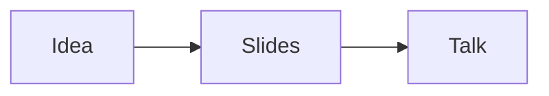

# My talk

A presentation made with Seminar

## The basics

What a slide can show

- Steps and columns
- Math and diagrams
- Code

### One idea at a time

- Start with the question
- :step Show the **evidence**
- :step Make the connection
  - Here are some
    - Nested list items
      - And even more

### Side by side

:::column[The question]
What do we want to understand?
:::

:::column[The evidence]
What have we learned?
:::

### Callouts

There is:callout[A callout]{color=error angle=-77 offset=50} and:callout[Another]{variant=outlined color=neutral angle=-144 offset=61}

:::callout[With title]{with=parent width=261 angle=-16 offset=65}

- Some
- Items
- In
- Body
  :::

:::callout[With title 2]{with=parent variant=outlined width=261 angle=164 offset=81 at=694,268}

- Some
- Items
- In
- Body
  :::

### A little math

Euler's identity: $e^{i\pi} + 1 = 0$.

### How it fits together



### Show your work

```ts
const answer = 42;
console.log(answer);
```
