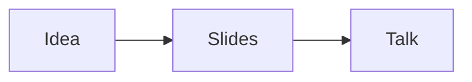

# My talk

A presentation made with Seminar

## The basics

What a slide can show

- Steps and columns
- Math and diagrams
- Code

### One idea at a time

- Start with the question
- :step Show the **evidence**
- :step Make the connection

### Side by side

:::column[The question]
What do we want to understand?
:::

:::column[The evidence]
What have we learned?
:::

### A little math

Euler's identity: $e^{i\pi} + 1 = 0$.

### How it fits together



### Show your work

```ts
const answer = 42;
console.log(answer);
```
